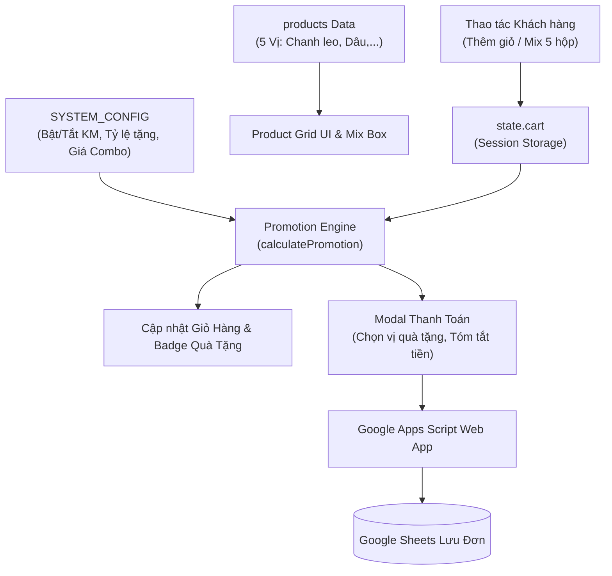

# HƯỚNG DẪN KỸ THUẬT & VẬN HÀNH HỆ THỐNG LA PANNA WEB
> **Tài liệu bàn giao & vận hành hệ thống website bán hàng La Panna Handcrafted Panna Cotta**  
> *Phiên bản:* 2.0 (Cập nhật Menu Khai Trương 10K & Promotion Engine Module Hóa)  
> *Ngày cập nhật:* 11/10/2026

---

## MỤC LỤC
1. [Tổng Quan Kiến Trúc Hệ Thống](#1-tổng-quan-kiến-trúc-hệ-thống)
2. [Cấu Trúc Thư Mục & Bản Đồ Truy Vết (Tracing Map)](#2-cấu-trúc-thư-mục--bản-đồ-truy-vết-tracing-map)
3. [Cơ Chế Khuyến Mãi Linh Hoạt (Promotion Engine)](#3-cơ-chế-khuyến-mãi-linh-hoạt-promotion-engine)
   - [3.1. Hướng dẫn BẬT / TẮT Khuyến Mãi](#31-hướng-dẫn-bật--tắt-khuyến-mãi)
   - [3.2. Hướng dẫn sửa đổi mốc tặng quà (Mua X tặng Y)](#32-hướng-dẫn-sửa-đổi-mốc-tặng-quà-mua-x-tặng-y)
   - [3.3. Hướng dẫn sửa đổi giá Combo Set 5 Hộp](#33-hướng-dẫn-sửa-đổi-giá-combo-set-5-hộp)
4. [Quản Lý & Thay Đổi Thực Đơn Sản Phẩm](#4-quản-lý--thay-đổi-thực-đơn-sản-phẩm)
   - [4.1. Đổi giá bán lẻ](#41-đổi-giá-bán-lẻ)
   - [4.2. Thêm hoặc ẩn hương vị bánh](#42-thêm-hoặc-ẩn-hương-vị-bánh)
5. [Tích Hợp Đồng Bộ Google Sheet (Google Apps Script)](#5-tích-hợp-đồng-bộ-google-sheet-google-apps-script)
   - [5.1. Luồng dữ liệu và Payload](#51-luồng-dữ-liệu-và-payload)
   - [5.2. Mã nguồn Google Apps Script mẫu (Code.gs)](#52-mã-nguồn-google-apps-script-mẫu-codegs)
   - [5.3. Các bước cấu hình Web App Google Sheet](#53-các-bước-cấu-hình-web-app-google-sheet)
6. [Quy Trình Kiểm Thử & Xử Lý Sự Cố (Troubleshooting)](#6-quy-trình-kiểm-thử--xử-lý-sự-cố-troubleshooting)

---

## 1. TỔNG QUAN KIẾN TRÚC HỆ THỐNG

Website La Panna được phát triển theo mô hình **Zero-Dependency Lightweight Client-Side Architecture** (Kiến trúc thuần Frontend nhẹ, không phụ thuộc framework cồng kềnh):
- **Ngôn ngữ cốt lõi:** HTML5 ngữ nghĩa, Vanilla CSS3 (Custom Design Tokens), Modern JavaScript (ES6+).
- **Backend không máy chủ (Serverless via Google Apps Script):** Tiếp nhận đơn hàng trực tiếp vào Google Sheets theo thời gian thực mà không phát sinh chi phí duy trì server hay database.
- **Triết lý thiết kế (Design Philosophy):** Config-Driven Development — Toàn bộ quy tắc khuyến mãi, giá bán, chính sách giao hàng và menu đều được tập trung vào đối tượng cấu hình `SYSTEM_CONFIG` giúp dễ dàng trace, bảo trì và thay đổi mà không cần can thiệp sâu vào luồng xử lý giao diện.



---

## 2. CẤU TRÚC THƯ MỤC & BẢN ĐỒ TRUY VẾT (TRACING MAP)

```text
lapanna-web/
├── index.html       # Cấu trúc giao diện: Top Announcement, Hero, Menu 10k, Set 5 hộp, Modal
├── style.css        # Hệ thống giao diện: Palette màu, typography, flyer card, giỏ hàng, animations
├── app.js           # Logic chính: SYSTEM_CONFIG, products, Promotion Engine, Cart, Submit Order
├── assets/          # Thư mục hình ảnh sản phẩm (Panna Cotta dâu, chanh leo, đào, kiwi, việt quất)
├── DOCS.md          # Tài liệu kỹ thuật chi tiết này
└── CNAME            # Tên miền tùy chỉnh khi deploy lên GitHub Pages / Hosting (lapanna.store)
```

### Bảng tra cứu các vị trí mã nguồn quan trọng trong `app.js`:

| Tính Năng / Nhiệm Vụ | Vị Trí Dòng / Hàm Trong `app.js` | Ghi Chú |
| :--- | :--- | :--- |
| **Cấu hình Bật/Tắt Khuyến Mãi** | `const SYSTEM_CONFIG = { ... }` (Dòng 14 - 55) | Thay đổi cờ `promotion.enabled` |
| **Danh sách 5 Vị Menu Khai Trương** | `const products = [ ... ]` (Dòng 63 - 110) | Thay đổi giá, tên, ảnh, mô tả |
| **Tính toán Khuyến mãi & Quà tặng** | Hàm `calculatePromotion(cart)` (Dòng 126 - 165) | Tự động tính số hộp tặng |
| **Logic Tự Phối Set 5 Hộp** | Hàm `initMixBox()`, `toggleMixFlavor()` | Chọn đủ 5 vị mới cho bấm thêm giỏ |
| **Giỏ hàng & Quản lý số lượng** | Hàm `addToCart()`, `updateCartUI()` | Tự động lưu vào SessionStorage |
| **Mở Modal & Dropdown Quà Tặng** | Hàm `openCheckoutModal()` | Sinh danh sách vị quà tặng miễn phí |
| **Bắn dữ liệu sang Google Sheet** | Hàm `handleOrderSubmit(e)` | Đóng gói JSON và gọi fetch API |

---

## 3. CƠ CHẾ KHUYẾN MÃI LINH HOẠT (PROMOTION ENGINE)

Toàn bộ logic khuyến mãi được điều khiển tập trung bởi object `SYSTEM_CONFIG.promotion` tại đầu file `app.js`:

```javascript
const SYSTEM_CONFIG = {
    promotion: {
        enabled: true,              // CỜ BẬT / TẮT CHÍNH
        id: 'KHAI_TRUONG_2026',
        title: 'Menu Khai Trương La Panna',
        dateRange: '11/10 ĐẾN HẾT 15/10',
        announcement: '🎉 MỪNG KHAI TRƯƠNG LA PANNA (11/10 - 15/10) • MUA 5 TẶNG 1, MUA 10 TẶNG 2 • FREESHIP KHU VỰC BKX',
        
        giftRule: {
            active: true,           // Bật/tắt riêng quy tắc tặng quà
            buyStep: 5,             // Cứ mua đủ 5 hộp
            freeGiftCount: 1,       // Được tặng 1 hộp
            tagText: 'Mua 5 tặng 1, mua 10 tặng 2'
        },

        combo5: {
            enabled: true,          // Bật/tắt combo
            size: 5,                // Kích thước combo: 5 hộp
            price: 45000,           // Giá khuyến mãi combo: 45.000đ
            regularPrice: 50000,    // Giá gốc khi mua lẻ 5 hộp: 50.000đ
            name: 'Set 5 Hộp Mix Vị Tùy Chọn'
        }
    }
};
```

### 3.1. Hướng dẫn BẬT / TẮT Khuyến Mãi
- **Khi kết thúc thời gian khai trương (sau 15/10) muốn TẮT khuyến mãi:**
  1. Mở file [app.js](file:///d:/Học Tập/2026.1/Thương mại điện tử/lapanna-web/app.js).
  2. Tại dòng 27: Đổi `enabled: true` thành `enabled: false`.
  3. **Kết quả tự động của hệ thống:**
     - Thanh Banner trên đầu trang (`#announcementBar`) tự động ẩn đi.
     - Quy tắc tặng quà (mua 5 tặng 1) tự động ngưng áp dụng.
     - Giỏ hàng và Modal thanh toán không còn sinh dòng quà tặng hay dropdown chọn vị quà.
     - Giá Set 5 hộp tự động điều chỉnh về 50.000đ.
- **Khi muốn BẬT lại (hoặc chạy sự kiện mới):**
  1. Đổi `enabled: true`.
  2. Cập nhật lại ngày `dateRange` hoặc câu thông báo `announcement` nếu cần.

### 3.2. Hướng dẫn sửa đổi mốc tặng quà (Mua X tặng Y)
Nếu muốn đổi chương trình từ "Mua 5 tặng 1" sang "Mua 4 tặng 1" hoặc "Mua 10 tặng 3":
- Trong `giftRule`:
  ```javascript
  buyStep: 4,        // Khách mua mỗi 4 hộp
  freeGiftCount: 1   // Sẽ được tặng 1 hộp
  ```
- Hàm `calculatePromotion(cart)` tự động thực hiện phép tính lũy tiến:
  $$\text{Số hộp quà tặng} = \lfloor \frac{\text{Tổng số hộp trong đơn}}{\text{buyStep}} \rfloor \times \text{freeGiftCount}$$
- Ví dụ: Khi khách mua 12 hộp (với `buyStep: 5`), số hộp tặng = $\lfloor 12 / 5 \rfloor \times 1 = 2$ hộp tặng.

### 3.3. Hướng dẫn sửa đổi giá Combo Set 5 Hộp
- Trong `combo5`:
  - `price: 45000`: Giá khách cần thanh toán khi chọn đủ 5 vị.
  - `size: 5`: Số vị tối đa khách phải chọn để hoàn tất set.

---

## 4. QUẢN LÝ & THAY ĐỔI THỰC ĐƠN SẢN PHẨM

Toàn bộ 5 hương vị theo menu khai trương được định nghĩa trong mảng `products` tại [app.js](file:///d:/Học Tập/2026.1/Thương mại điện tử/lapanna-web/app.js):

```javascript
const products = [
    {
        id: 1,
        name: 'Panna Cotta Chanh Leo',
        flavor: 'Chanh leo',
        price: 10000,
        img: 'assets/mango_panna_cotta_1790435259241.png',
        tag: 'Best Choice',
        tagType: 'danger',
        desc: 'Sốt chanh leo vàng ươm thanh mát, chua dịu hòa quyện lớp kem sữa dẻo mịn'
    },
    // ... các vị Dâu, Việt quất, Kiwi, Đào
];
```

### 4.1. Đổi giá bán lẻ
- Muốn đổi giá của từng vị: Thay đổi trường `price: 10000` thành số tiền mong muốn (ví dụ `12000`).
- Hệ thống sử dụng hàm `formatMoney(amount)` sẽ tự động hiển thị ra định dạng tiền tệ Việt Nam (Ví dụ: `12.000đ`).

### 4.2. Thêm hoặc ẩn hương vị bánh
- **Muốn thêm vị thứ 6:** Thêm 1 object vào mảng `products` với `id: 6`, khai báo đầy đủ tên, ảnh (`assets/...`), và `flavor`. Cả giao diện Menu chính và lưới chọn Mix Vị sẽ tự động nhận diện vị mới.
- **Muốn tạm ẩn một vị:** Chỉ cần chú thích (`//`) phần tử đó trong mảng `products`.

---

## 5. TÍCH HỢP ĐỒNG BỘ GOOGLE SHEET (GOOGLE APPS SCRIPT)

### 5.1. Luồng dữ liệu và Payload
Khi khách hàng bấm **"Xác Nhận Đặt Hàng"** trên website, hàm `handleOrderSubmit` sẽ đóng gói toàn bộ dữ liệu thành một JSON payload và bắn tới endpoint Web App của Google Apps Script:

```json
{
  "name": "Nguyễn Văn A",
  "phone": "0987654321",
  "address": "Phòng 302 KTX B10 Đại học Bách Khoa",
  "notes": "Giao sau 16h chiều, cho thêm thìa",
  "totalCups": 6,
  "freeGifts": "1 hộp (Vị: Dâu)",
  "promotionApplied": "Menu Khai Trương La Panna",
  "cartDetails": "• Set 5 Hộp Mix Vị Tùy Chọn x1 (45.000đ)\n  - Vị: Dâu (x2), Chanh leo (x1), Kiwi (x2)\n• Panna Cotta Đào x1 (10.000đ)",
  "totalPrice": "55.000đ",
  "shippingArea": "FREESHIP KHU VỰC BKX (Bách Khoa - Kinh Tế - Xây Dựng)",
  "orderDate": "11/10/2026, 17:30:00"
}
```

> **Ghi chú kỹ thuật về CORS:** Client gửi `Content-Type: text/plain;charset=utf-8` để trình duyệt không kích hoạt CORS Preflight (OPTIONS request), giúp Google Apps Script xử lý mượt mà 100% không bị chặn.

### 5.2. Mã nguồn Google Apps Script mẫu (Code.gs)
Chủ tiệm hoặc lập trình viên mở Google Sheet -> chọn **Tiện ích mở rộng (Extensions)** -> **Apps Script** và dán đoạn mã sau:

```javascript
/**
 * GOOGLE APPS SCRIPT - BỘ TIẾP NHẬN ĐƠN HÀNG LA PANNA
 * Nhận dữ liệu POST từ website và ghi trực tiếp vào Google Sheet
 */
function doPost(e) {
  try {
    var sheet = SpreadsheetApp.getActiveSpreadsheet().getActiveSheet();
    var data = JSON.parse(e.postData.contents);
    
    // Nếu sheet còn trống, tự động tạo hàng tiêu đề (Headers)
    if (sheet.getLastRow() === 0) {
      sheet.appendRow([
        "Thời Gian Đặt",
        "Họ Tên Khách",
        "Số Điện Thoại",
        "Địa Chỉ Giao Hàng",
        "Tổng Số Hộp",
        "Quà Tặng Khuyến Mãi",
        "Chương Trình KM",
        "Chi Tiết Đơn Hàng",
        "Tổng Tiền",
        "Khu Vực Giao Hàng",
        "Ghi Chú Của Khách"
      ]);
      
      // Định dạng dòng tiêu đề
      var headerRange = sheet.getRange(1, 1, 1, 11);
      headerRange.setBackground("#C91C3E");
      headerRange.setFontColor("#FFFFFF");
      headerRange.setFontWeight("bold");
    }
    
    // Thêm dòng dữ liệu đơn hàng mới
    sheet.appendRow([
      data.orderDate || new Date().toLocaleString("vi-VN"),
      data.name,
      "'" + data.phone, // Dấu nháy đơn để giữ số 0 đầu số điện thoại
      data.address,
      data.totalCups,
      data.freeGifts,
      data.promotionApplied,
      data.cartDetails,
      data.totalPrice,
      data.shippingArea,
      data.notes
    ]);
    
    return ContentService.createTextOutput(JSON.stringify({
      status: "success",
      message: "Đơn hàng đã được lưu thành công!"
    })).setMimeType(ContentService.MimeType.JSON);
    
  } catch (error) {
    return ContentService.createTextOutput(JSON.stringify({
      status: "error",
      message: error.toString()
    })).setMimeType(ContentService.MimeType.JSON);
  }
}
```

### 5.3. Các bước cấu hình Web App Google Sheet
1. Bấm nút **Deploy (Triển khai)** -> **New deployment (Triển khai mới)**.
2. Chọn loại: **Web app**.
3. **Execute as (Thực thi dưới tên):** *Me (Tôi)*.
4. **Who has access (Ai có quyền truy cập):** **Anyone (Bất kỳ ai)** *(bắt buộc để website có thể gửi dữ liệu không cần đăng nhập)*.
5. Sao chép URL Web App vừa tạo (có dạng `https://script.google.com/macros/s/.../exec`).
6. Dán URL vào biến `GOOGLE_SHEET_URL` ở dòng 398 trong file [app.js](file:///d:/Học Tập/2026.1/Thương mại điện tử/lapanna-web/app.js).

---

## 6. QUY TRÌNH KIỂM THỬ & XỬ LÝ SỰ CỐ (TROUBLESHOOTING)

### 6.1. Ma trận kiểm thử đơn hàng (Test Cases)

| Kịch Bản Kiểm Thử | Hành Động | Kết Quả Mong Đợi |
| :--- | :--- | :--- |
| **Mua lẻ 1 đến 4 hộp** | Thêm 1-4 hộp lẻ bất kỳ | Giá 10k/hộp; không có quà tặng khai trương |
| **Mua đúng 5 hộp lẻ** | Thêm 5 hộp lẻ | Tổng tiền 50k; Kích hoạt quà tặng: **Tặng 1 hộp** |
| **Mua Set 5 hộp mix** | Chọn đủ 5 vị trong Mix Box | Giá áp dụng **45k** (tiết kiệm 5k); Kích hoạt: **Tặng 1 hộp** |
| **Mua 10 hộp (2 Set)** | Thêm 2 Set 5 hộp | Tổng tiền 90k; Kích hoạt: **Tặng 2 hộp** |
| **Chọn vị quà tặng** | Mở Modal thanh toán | Dropdown vị quà hiển thị đầy đủ 5 vị hoặc 'Shop tự mix' |
| **Tắt cờ khuyến mãi** | Đặt `enabled: false` | Ẩn banner top, tắt tính quà tặng, Set 5 hộp về giá 50k |

### 6.2. Các sự cố thường gặp & cách khắc phục

1. **Khách đặt hàng nhưng Google Sheet không nhận được dòng mới:**
   - *Nguyên nhân:* Google Apps Script chưa được phân quyền "Anyone" (Bất kỳ ai), hoặc URL Web App bị sai.
   - *Khắc phục:* Mở Apps Script -> Deploy -> Manage deployments -> Chỉnh sửa -> Đảm bảo `Who has access = Anyone`. Nếu sửa code Apps Script, phải tạo một Version Deployment mới.
2. **Số điện thoại bị mất số 0 đầu tiên trong Excel / Google Sheet:**
   - *Khắc phục:* Trong `Code.gs`, dữ liệu phone đã được tự động thêm tiền tố `"'"` (dấu nháy đơn) để Google Sheet hiểu là chuỗi ký tự (Text).
3. **Giao diện không hiển thị thay đổi mới:**
   - *Khắc phục:* Trình duyệt có thể lưu cache tệp `style.css` hoặc `app.js`. Nhấn tổ hợp phím `Ctrl + F5` (hoặc mở cửa sổ ẩn danh) để tải lại toàn bộ tài nguyên mới nhất.

---
*Tài liệu được soạn thảo hoàn chỉnh phục vụ bảo trì hệ thống website thương mại điện tử LA PANNA.*
